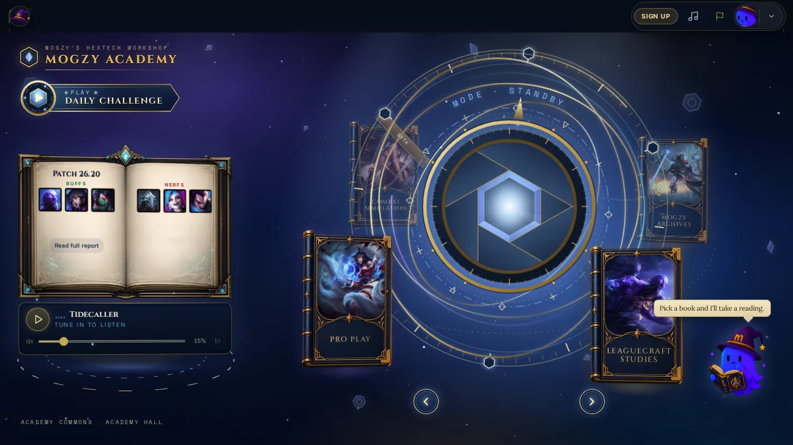
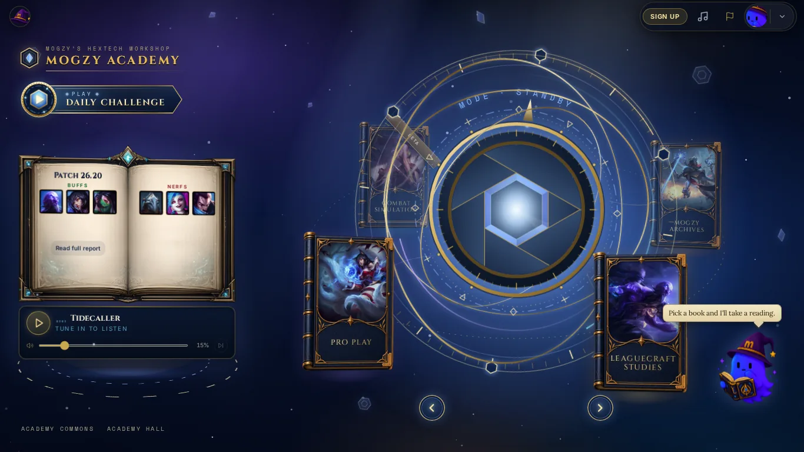
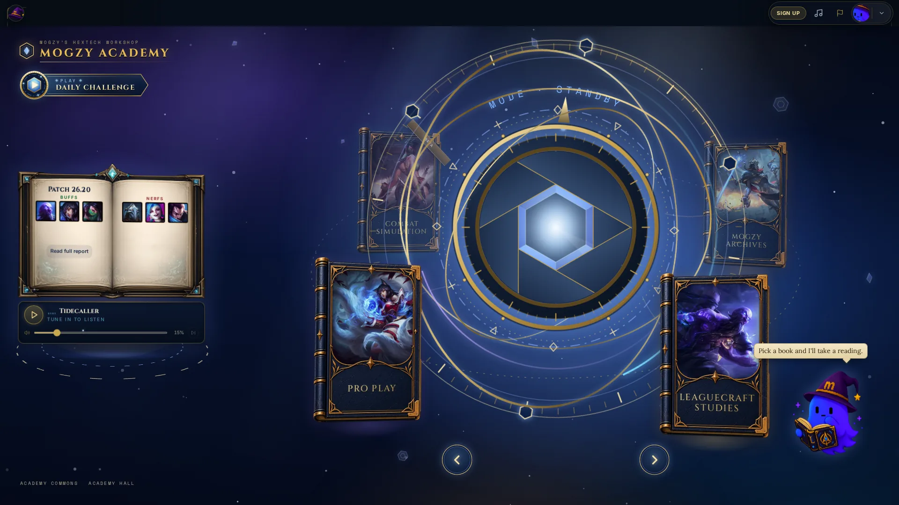
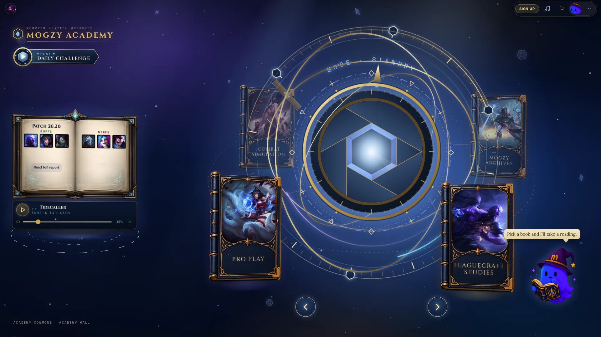
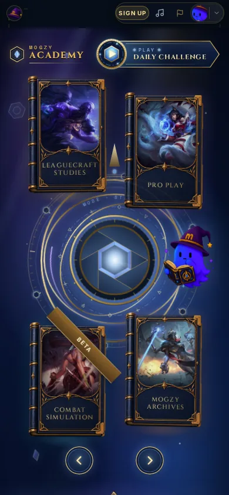
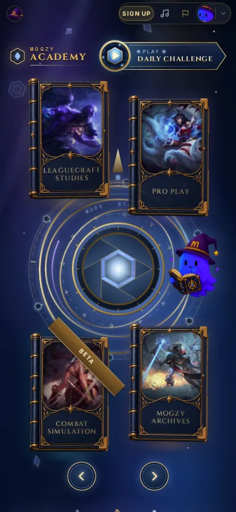
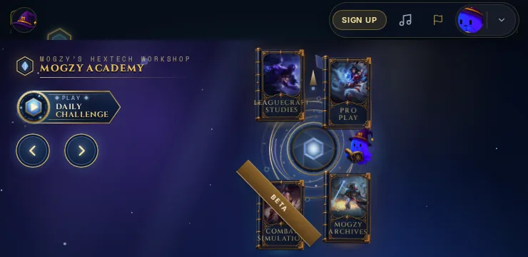
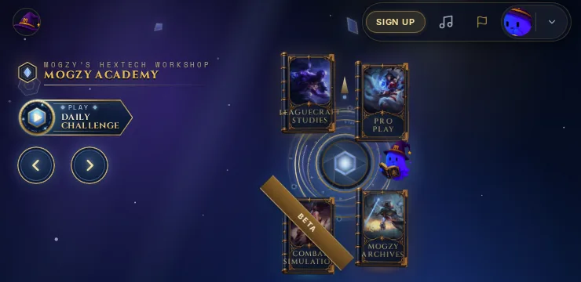

# Academy — Seamless Top HUD

**Status:** draft PR [mitcherrman/mogsy#111](https://github.com/mitcherrman/mogsy/pull/111), branch `academy/seamless-hud`, base `main` 657b4a91. **Owner visual review required. Not merged, not published.**

## What changed for the visitor

On `/lol` only, the Living Hextech Orrery's sky (navy, violet, blue, stars, light shafts, fragments) now runs to the top edge of the viewport. The dark strip that sat behind the HUD is gone, and so is its hard edge where the sky began. The HUD controls (home hat, Sign up, music, report, Mogzy portrait, notifications chevron) float in the Academy environment with no enclosing bar. They keep their own existing glass chips.

| | before | after |
|---|---|---|
| 1366×768 |  |  |
| 1920×1080 |  |  |
| 390×844 |  |  |
| 320×568 |  |  |
| 740×360 |  |  |

Also captured after the change (in `academy-seamless-hud/`):
- `after-menu-identity-1366` and `after-menu-identity-390`: the guest panel over the Orrery.
- `after-focus-home-1366`: the first Tab stop's focus ring.
- `after-scrolled-390x844`: the page scrolling under the HUD.
- `after-reduced-390x844`: reduced motion.

The full sets, including the radio and report panels, `/quiz` and `/lol/hall`, are in the CI artifacts `academy-seamless-hud-before` and `academy-seamless-hud-after`. Book poses differ between before and after only because the orbit was at a different moment when each capture was taken.

## How (CSS only)

| File | Change |
|---|---|
| `src/pages/academy-core/orrery/academy-core-seamless-hud.css` | **new**, 38 lines, every rule under `.o35-root` |
| `src/pages/academy-core/AcademyCorePage.tsx` | +1 line: imports it last, after `academy-core-phone-fit.css` |
| `src/pages/academy-core/orrery/academy-core-seamless-hud.test.ts` | **new**, source-contract unit test |
| `e2e/academy-seamless-hud.spec.ts` | **new**, CI capture and acceptance spec |
| `e2e/academy-seamless-hud-compare.mjs` | **new**, before/after geometry comparison |
| `.github/workflows/academy-seamless-hud.yml` | **new**, CI workflow |
| `docs/handoffs/ACADEMY_SEAMLESS_HUD.md` and `academy-seamless-hud/*.webp` | this handoff and its stills |

The mechanism:

```
.o35-root   margin-top  − band    the Academy page starts at the viewport top
.o35-hero   padding-top + band    its content starts exactly where it did
.o35-hero   min-height  + band    its content box is exactly the same size
```

Here `band` is `var(--app-header-h)`: 3rem on phones and 3.5rem from 640px up. The sky (`.o35-env`, `inset: 0` in the hero) therefore also covers the band. The fixed HUD (`z-index: 50`) stays above `<main>` (`z-index: 20`), as before.

**Not touched:** `--app-header-h`, `--app-viewport-h`, the phone height budget (`--o35-above-h` / `--o35-below-h`, `composed-fit.ts`), `Layout.tsx`, `GlobalHud.tsx`, `index.css`, the global header colours, authentication, analytics, menus, focus styles, the z-index ladder and scrollbar compensation (`--removed-body-scroll-bar-size`). Also untouched: the RC2.2 veil, the crest, the Daily seal, the four-book layout, and #95's motion and pointer code. No new media, blur, animation or layer. Ranked remains absent.

Only `/lol` renders `.o35-root` (the old dev Orrery URLs all redirect to `/lol`). The stylesheet stays loaded after you navigate away, but it matches nothing elsewhere.

## Validation

**Local (no browsers, per AGENTS.md)**
- `npx vitest run src/pages/academy-core src/lib/academy-startup src/components/startup src/components/hud`: **21 files, 367/367 passed**, including the 6 new contract tests.
- `npm run build` (vite build, prerender, verify): **passed**. The rule ships in `AcademyCorePage-*.css`.

**GitHub Actions (bundled headless Chromium)**: workflow `academy-seamless-hud`
- `capture (before)` runs the same spec on the PR base's `src`, and `capture (after)` runs it on head. Each covers the five required viewports, plus menus (guest panel, radio, report), keyboard focus, scrolling, the startup veil, reduced motion, `/quiz` and `/lol/hall`.
- `compare` fails if any recorded box moved by more than 0.5px: stage, masthead, Daily seal, Patch Report, HUD home, HUD cluster, hero bottom, document height and width, and `<main>` on `/quiz` and `/lol/hall`.

Run 1 (c7309679):
- `/lol` cases: 10/10 before and 10/10 after.
- `compare`: geometry **identical** at all five viewports.
- One spec defect: the `/quiz`/`/lol/hall` case asserted that `<main>` starts at the band. It failed identically on the untouched base (56px), so the assumption was wrong, not the app. Fixed in 3fcf3d8f, which records those routes for the compare instead.

Run 2 (3fcf3d8f, run 39547106733): **all green**. That is `capture (before)`, `capture (after)` and `compare`, including `/quiz` and `/lol/hall` identical before and after at 1366×768 and 390×844.

**Seam score.** This is the mean RGB step between the pixel rows on either side of the band's lower edge, measured in the band's empty middle. The "ordinary" step is the one between rows a little lower in the sky.

| viewport | band | before | after | ordinary sky step |
|---|---|---|---|---|
| 1366×768 | 56 | 18.69 | **1.33** | 1.34 |
| 1920×1080 | 56 | 19.97 | **1.17** | 1.11 |
| 390×844 | 48 | 19.55 | **3.55** | 2.92 |
| 320×568 | 48 | 22.58 | **1.37** | 1.23 |
| 740×360 | 56 | 15.19 | **1.15** | 4.31 |

The sky starts at y = 0 at every viewport, in reduced motion, and right after the veil lifts. Before the change it started at y = 48 or 56.

At every viewport, before and after scrolling, all six HUD controls hit-test at their centres. There is no horizontal overflow, and the HUD stays at `z-index: 50`.

**Other workflows on this PR**
- `academy-masthead-review` and `Gameplay Analytics Acceptance`: green.
- `academy-core-orrery`: green on run 2. On run 1 its only failure was `selector › the whole orbit turns`, the known flaky case that also fails on `main`; Vitest 248/248 and the V3 spec 23/23 passed there.

## Performance impact

- About 0.5 KB of CSS in the existing lazy Academy chunk. No JS, no media, no new elements, no filters or blur.
- The environment box grows by the band's height, 48–56px, which is about 7% more sky at 1366×768. The parallax layers, which already have `will-change`, grow by the same proportion. The stars, aurora and fragment counts are unchanged.

## Integration risks

1. **Restated values.** The new file repeats the hero's padding-top (`clamp(0.5rem, 1.6vh, 1.25rem)` on desktop, `0.5rem` stacked) and its desktop min-height, each plus the band. If a later pass changes those in `academy-core-v35.css` or `academy-core-masthead.css`, the content would shift. The unit test `academy-core-seamless-hud.test.ts` reads both source rules and fails on any drift, so update this file at the same time.
2. **Import order.** This file must stay the last Orrery stylesheet import. The test asserts this.
3. **#95 (hover-to-front, on hold).** It touches no file here. Pointer and hit-testing geometry inside the stage is unchanged, so its fixed-coordinate tests are unaffected.
4. **The band's empty middle** still passes clicks through to the page. The HUD wrapper is `pointer-events: none` and the sky is `pointer-events: none`, so nothing new can catch a click there.
5. **Startup:** the veil is a fixed full-viewport overlay above everything. It lifts onto a sky that already fills the band, as `startup` in CI confirms. The `AcademyCoreFallback` chunk placeholder (`App.tsx`) is unchanged and is only seen under the veil.

## Owner questions

- On busy phones, should the top of the sky be slightly darker behind the right HUD cluster (a CSS-only gradient)? The chips are legible in every capture, so nothing was added.

## Not done

- Not merged, not published to Lovable.
- No real-GPU or real-device look, and no Safari check (CI is Chromium only).
