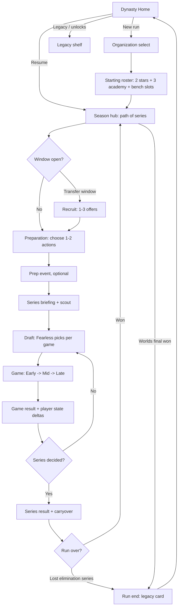
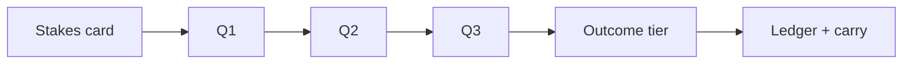

# Worlds Dynasty UX-D0: gameplay experience and interface specification

**Status:** DESIGN SPEC for owner review. Documentation only. No page, route, auth, shared CSS, schema, asset or existing Dynasty PR was touched.
**Date:** 2026-10-17. **Branch:** `ux/ux-d0-dynasty-design` (cut from `roguelike/rog1d1-dynasty-frontend` @ `14702285` so the existing prototype can be cited; nothing from that branch is modified).
**Inputs read:** `WORLDS_DYNASTY_MASTER_GAME_PLAN_UPDATED_2026-10-17.md` (esp. §§7, 16-21), `WORLDS_DYNASTY_EVENTS_E0_CONTRACT.md`, `MOGZY_COMMAND_CENTER_HANDOFF_2026-10-13.md` (operating principles: reuse mature Mogzy UI, verify before claiming, separate completion layers), `docs/roguelike/WORLDS_DYNASTY_ROG1D1_FRONTEND.md`, and the frontend source cited per section.
**Method and limits:** Everything below about existing components is from reading source in the D1 worktree. I did not run the app or view screenshots for this pass, so layout claims are design intent, not measured results. All names, numbers and stats in this document are synthetic (`SYN-`). Numeric values are placeholders for layout, not balance proposals.

Status tags follow the master plan: **[A]** approved, **[D]** owner direction, **[P]** this spec's proposal, **[O]** open owner decision.

---

## 0. Design thesis

The master plan's north star is: *roster defines strengths, preparation changes opportunities, a few interventions steer, RNG adds uncertainty, the season remembers.* The UI has to make each of those five clauses visible in under a second of looking at a screen.

Five principles drive every screen:

1. **One decision per screen.** A screen asks for one thing (pick an org, pick two prep actions, lock a champion, answer a question). Everything else is read-only context that collapses.
2. **Show the stakes before the choice, the reasons after.** Choices preview *direction and phase* ("helps Early, costs Fatigue"), never the roll. Results offer a one-line reason with an optional expand.
3. **Small persistent state, big temporary drama.** Visible run state is capped at the master plan's minimal model: per-player **Confidence** and **Fatigue**, a team **Cohesion** meter, and an in-match-only **Pressure** badge. [P] "Form" is not displayed separately in v1 (see O-2).
4. **Speed over spectacle.** A full game should take about 60-90 s of reading/tapping, a BO5 about 5-7 min, and a run about 30-45 min. Reveals are tap-to-advance with a skip. Animation explains cause and effect, then exits (the Worlds-experience rule: "motion explains where things went and gets out of the way").
5. **Two truths, always labelled.** Every consequential number carries one of three chips: **Verified real-world evidence**, **Dynasty rules**, **Generated in-run event** [D §17]. A synthetic fixture adds the existing amber "Owner prototype" banner.

---

## 1. Findings from the frontend investigation

What exists and is directly reusable (verified present in the D1 worktree; paths relative to repo root):

| Area | What exists | Why it matters for Dynasty |
|---|---|---|
| Dynasty prototype (D1) | `src/pages/admin/dynasty/*` (page shell, `PhaseRail`, `SyntheticBanner`, player card, roster rail, lane + team battle reveal, roll strip), `src/lib/dynasty/{contracts,client,model,fixtureTransport}.ts` | Fail-closed contract parsing, one-action-in-flight controller, resume/retry/stale-seq handling, and a reveal pattern with skip and reduced-motion. All survive into v2; only phases and view models change. |
| Worlds look | `src/components/pro-play/worlds-experience/parts.tsx` (`SURFACE`, `GOLD_TEXT`, `Eyebrow`, `Figure`, `SideMark`, `rovingKeys`) and `motion.ts` (`EASE_OUT`, `DURATION`, `OFFSET`, `slideVariants`) | The navy-plate / gold-hairline language already used by D1. `motion.ts` gives one curve, no springs, reduced-motion = opacity only. Adopt as-is. |
| Ranked arena | `src/components/ranked-arena/*`: `ArenaShell`, `CentralStage` (header focal display), `ModuleBubble` (3-state token), `RoundTimeline`, `QuestionPanel`, `AnswerGrid`, `RevealPanel`/`RevealBanner`, `AwardPops`, `MatchOverFrame`, `MobileBottomBar`, `RoleEmblem`, and CSS tokens `--ranked-*` (`#07111f` deep, `#b9934c` gold, `#efe8d6` text, `--ranked-stage-h` definite-height rule) | The question/answer experience for objective encounters, plus the phone layout contract (definite stage height, bottom bar). The "number is the base, dot is the bonus" token discipline is the model for "outcome plus risk dot" chips. |
| Result vocabulary | `src/components/game-results/*` (`GameResultsShell`, `ResultHero`, `ResultTimeline`, `ResultStatGrid`, `ResultProgress`, `model.ts`) | A shared result model whose rule is "every field optional, absent renders nothing". Use for the series and run end screens instead of inventing a new one. |
| Journey board | `src/components/journey/JourneyStateBoard.tsx` (two densities via container query on the band: side-by-side vs stacked), `JourneyTransitionBeat.tsx` (in-place delta animation, one compact stamp, full lines in a visually hidden status region), `JourneyStateSheet` | The best existing pattern for "state changed" feedback without a blocking screen. Direct model for the post-game mental-state delta and the stage scoreboard. |
| Evidence | `src/components/pro-play/ProPlayEvidence.tsx` (server-formatted `display` strings shown verbatim, mounted only after answer, renders only fields present), `dossier/*`, `media/EntityCrest.tsx` (`PlayerPortraitSlot` monogram), `media/EventMark.tsx` | Optional explanation panel "why this baseline". "Show server's formatting verbatim" is exactly the no-fabrication rule. |
| Hosted knowledge | Ranked match host + `CanonicalArena`; `interaction-grammar/{OrderForge,DataDuel}`; owner labs under `src/pages/dev/{pro-play-assembly,rangefinder,match-grid,combat-estimate,word-puzzle,interaction-lab}` | The three-question encounter can mount a real `CanonicalArena` (as Rangefinder R1 did) instead of a bespoke quiz UI. |
| Cards | `src/pages/dev/champion-card-duel/ChampionCardDuelPage.tsx` (`LanePlaque`, `SocketFrame`, hex/octagon clips) is a 2,000+ line dev page; ROG0 already flagged that extracting `GameCard`/`FlippableCard` would touch it. | Visual inspiration for lane tiles. **Do not extract in UX work**; Dynasty builds its own light tile and borrows tokens. |
| Champion/role art | `ChampionIcon` (several variants: `pro-play/dossier/DossierMedia.tsx`, `journey/JourneyIcons.tsx`, `esports/live/components.tsx`), `lib/quiz/championKnowledge.ts#championIconPath`, `RoleEmblem`, `MogzyMascot`/`RoleMascot` | Use one `ChampionIcon` (dossier variant: it is the pro-play one that matches Dynasty's data domain; confirm at build). Synthetic champions have no art; keep the key + class glyph fallback seen in D1. |
| Audio | `useSfx().play(cue)`; registry cues include `ui.button.press`, `ranked.discovery.reveal`, `ranked.answer.correct/incorrect/lock`, `ranked.points.awarded`, `ranked.round.final`, `ranked.match.victory/defeat`, `ranked.opponent.found`, `ranked.record.open/close`, `hub.book.open` | A v1 sound map needs no new audio (Section 13). Dedicated `dynasty.*` cues are later work (D1 doc already lists it). |
| Motion gate | `useMotionAllowed()` in `src/lib/motion/useReveal.ts`, Tailwind `motion-safe:` utilities, `tailwindcss-animate`, framer-motion | The only animation switch to use. |
| UI kit | `src/components/ui/{sheet,tabs,accordion,collapsible,popover,tooltip,progress,badge,button,dialog,switch}` | Bottom sheets, tabs, disclosure and progress are covered. No new design system. |

Gaps found: (a) no existing season/calendar map component; (b) no "draft board with composition read-out" component; (c) Dynasty has no portraits or champion art for synthetic data (monogram fallback is correct); (d) the ranked CSS tokens are scoped to the arena, so Dynasty surfaces should keep using the Worlds `SURFACE` tokens and only borrow arena tokens inside an embedded arena.

**Recommendation:** no new design system. Dynasty = Worlds-experience plates and typography + Ranked arena only where a real question is asked + Journey-style in-place deltas + Game-results for endings.

---

## 2. Screen flow (whole run)



### Inside one game

```mermaid
flowchart LR
  A[Locked draft] --> B[Early open]
  B --> B1[1-2 small events]
  B1 --> B2[Major event, pre-score]
  B2 --> B3[Score: 5 lanes + team = 7]
  B3 --> B4[Early label, 5 states]
  B4 --> C[Mid open: carry applied]
  C --> C1[small events] --> C2[pre-score major] --> C3[Score 7]
  C3 --> C4{Winning + Winning?}
  C4 -->|Yes| Z[Closeout: game over at Mid]
  C4 -->|No| C5[Post-stage objective, e.g. Baron 3Q]
  C5 -->|3 of 3 and closeout offered| Z
  C5 --> D[Late open: carry applied]
  D --> D1[small events] --> D2[major event 1-2] --> D3[Score 7: 4+ wins]
  Z --> R[Game result]
  D3 --> R
```



Rule reflected in the UI: after a Mid closeout the Late column is never rendered (not greyed, not "skipped"), because Late events must not be generated [E0 §1].

---

## 3. Dynasty home and campaign progression

**Goal:** get a returning player into the run in one tap, and show the run as a *journey* rather than a menu.

Home states (single route, state-driven, so resume is automatic):

```
[ banner: Owner prototype / synthetic catalog ]            (until real catalog)
┌──────────────────────────────────────────────┐
│ WORLDS DYNASTY            patch pin: syn.p1   │
│ ┌────────── Resume run ──────────┐            │
│ │ SYN Org Crest  Week 4/10        │  [Continue]│
│ │ Regular season · Series 2 of 4  │            │
│ │ 5 starters · 2 bench · Cohesion ▮▮▮▯▯       │
│ └─────────────────────────────────┘            │
│ [ New run ]   [ Legacy shelf ]  [ How it works ]│
└──────────────────────────────────────────────┘
```

- **Resume card** reads the server snapshot (existing D1 idempotent `start_key` resume). It is the largest element if a run exists.
- **Version pin** [D §17]: the run's catalog/rules/event versions show as one chip ("syn.p1") that opens a sheet listing each version component. A new run uses current released versions; an old run keeps its own. Never silently upgrade.
- **Legacy shelf** shows earned unlocks (alternate pools, orgs) and past run cards. Unlocks open options; they do not add generic power [D §21].

**Season hub / campaign map** (the core progression screen). Use a *path*, not a calendar grid [P], because the master plan wants a compressed season and rejects day-by-day micromanagement:

```
Regular Season ─●─●─◐─○── Playoffs ─○─○── Play-In? ─○── Worlds ─○─○─○─★
        series done ┘ you are here        locked bracket, preparation routes branch
```

- Each node is a **series** (BO5). Node states: done (shows 3-1 style score), current, upcoming (shows scouting level), locked.
- Between nodes, a **gap strip** shows what the gap offers: Prep (always), Transfer window (some), Event (some). Icons only, one line label.
- Opponent identity is **committed before preparation** and scouting reveals tags progressively [D §9]; the node shows `Scouted: ● ● ○` (three tiers), never invented hidden info.
- **Preparation routes branch, bracket stays fixed** [P §2]: from the gap strip the player chooses among 2-3 prep "routes" (e.g. "Scrim block", "VOD + scout", "Rest and bond"), which feed Section 5.
- Persistent **run bar** (all screens inside a run): org crest, node label, series record, Cohesion meter, roster button. On phones it is a 44 px top bar; the roster opens as a bottom `Sheet`.

Open question: number of nodes and elimination rules are [O]; the map is data-driven so 6-12 nodes render without redesign.

---

## 4. Organization selection and gradual recruitment

### 4.1 Organization select

A horizontal snap carousel of 3 org cards (more via "show all"), each with:

- fictional crest (`SideMark`/`EntityCrest` style), name (`SYN-`), region chip;
- a **one-line identity** ("front-to-back teamfighting; Late +, Early −") from the *organization trait* [D §16];
- two **strength chips** and one **weakness chip** drawn from the 7 capability tags and 3 phases;
- starting signing preview: the two stars, with a "counter-balance" hint ("train Early to offset");
- a **label chip** "Dynasty rules" (the trait is a rule construct, not a claim about the real org).

Interaction: tap card to focus (shows roster preview), second tap on "Choose" confirms. Same select-then-confirm two-step as D1 draft. No numeric power shown, only chips and bars bucketed to 5 levels.

Replay hook: 3 offered at random per run from the pinned catalog (seeded, server-held), plus a "Pick any unlocked" lane for unlocks. Offering 3 keeps the choice fast and varied.

### 4.2 Gradual recruitment

[P] flow matching the master plan's preferred example (stars + academy), flagged [O] against a plain five-starter alternative:

1. **Choose 2 stars** from 3 offers each (reuse D1 `PlayerCard` + the select/confirm step).
2. **Academy fill:** three clearly fictional academy players are auto-assigned to the remaining roles. Shown on cards with an **ACADEMY** ribbon and no rarity frame. This explains why the team starts weak in places.
3. **Transfer windows** (on the season path): 1-3 offers, a *signing* costs a roster slot decision, not currency [P: no salary in v1]. Offer screen shows the **swap preview**: who is displaced, what relationships break, honeymoon marker if applicable.

Offer card contract (compact; reuse and trim the D1 card):

```
┌ ROLE emblem  SYN-Aurel Voss     ★ Academy|Star ┐
│ Early ▮▮▯▯▯  Mid ▮▮▮▮▯  Late ▮▯▯▯▯              │  5-bucket bars, phase labelled
│ Pool: ChampA · ChampB · ChampC   (top 3)         │
│ Links: ♥ duo with SYN-Kei (verified history)     │  label chip: Verified real-world
│ New-signing: honeymoon 2 series                  │  label chip: Dynasty rules
└ [Compare] [Sign] ────────────────────────────────┘
```

- **Compare** opens a two-column sheet (candidate vs incumbent), only differences highlighted.
- No rarity-as-power: rarity is a frame only and the card says "cosmetic" (D1 convention).

---

## 5. Starting roster, substitutes and player characteristics

**Roster screen** (also the `Sheet` opened from the run bar). Five starter slots in role order, two bench slots below. Slot = compact player row:

```
[RoleEmblem] SYN-Aurel Voss     Conf ◆◆◆◇◇   Fatigue ▮▮▯▯▯   ⚑ Honeymoon
             E ▮▮▯▯▯ M ▮▮▮▮▯ L ▮▯▯▯▯          pool: 3 champs · ★ trait: Calm closer
```

Visible characteristics (and nothing else by default):

| Group | Shown | Source label |
|---|---|---|
| Phase skill | Early / Mid / Late, 5-bucket bars | Verified real-world evidence (baseline), tap for Section 12 |
| Champion proficiency | top 3 chips; tap for full pool | Verified real-world evidence |
| Confidence | 5-pip diamonds, with last-game arrow | Dynasty rules (in-run) |
| Fatigue | 5-bar | Dynasty rules (in-run) |
| Traits | at most 2 earned run traits, e.g. "Overconfident" | Generated in-run event |
| Links | duo markers to other players | History = Verified; developed = Dynasty rules |

- **Pressure** is not on the roster; it appears only inside a match (Section 8).
- Bench management: drag on desktop, "Swap" button on phone (pick starter, then bench player of the **same role only** per [A] current rule; emergency role swap [O]).
- **Cohesion** is one team meter in the run bar plus a "Links" tab on the roster sheet listing explicit pair bonuses only. Avoid a full relationship graph in v1 [P §4].
- The 5-bucket bars are intentionally coarse. The honest precision lives in the explanation panel.

---

## 6. Preparation activities and player development

**Action budget:** 1-2 choices per gap [D §5]. Screen = a grid of action cards with a two-slot tray.

```
Preparation  ·  2 actions left            [Fatigue risk shown on cards]
┌ Solo Queue ┐ ┌ Scrims ┐ ┌ VOD Review ┐ ┌ Team Bonding ┐ ┌ Rest ┐ ┌ Champ Practice ┐ ┌ Experiment ┐
 target: 1 player   team        scout/Late     cohesion      recover    1 champion     variance
 helps E            Mid+some E/L  intel                      fatigue −   familiarity
 cost: fatigue +1   fatigue +1    -            -            -           -
```

Each card shows only four things: **Who** (player picker or "team"), **Helps** (phase chips E/M/L), **Cost/Risk** (Fatigue, variance, narrowness), and an **Opportunity cost** line ("uses a slot"). Diminishing returns are shown as a visible "second use this week: reduced" tag so the player never sees a mystery.

- Selecting an action that needs a target opens a one-row player picker (bottom sheet on phones).
- **Preview delta before confirm**: Confidence/Fatigue/phase chips tick preview arrows on the affected rows (the Journey "marks" pattern). This is the "show tradeoffs *before* choices" requirement [D §11].
- **Knowledge-backed actions:** VOD Review, Solo Queue and Scrims can open a hosted Mogzy activity (Section 8.3 host). The card gets a **Knowledge** tag and a stakes line ("Perfect = full effect, otherwise partial"). Rewards come only from server-verified results [A]. Non-knowledge actions resolve instantly. Not every action is a quiz; the mix keeps pacing varied and avoids the "serial quizzes" failure [P].
- **Confirm** commits both actions at once; a single "Run prep" beat plays (≤1.2 s, skippable) and the roster rows animate their deltas in place.
- Optional prep event (Section 7) triggers here sometimes.

Development over time: cumulative training appears as a small "Growth" ledger on the player detail sheet ("+1 Early from solo queue, week 3"), always labelled as a Dynasty rule, never as real-world development.

---

## 7. Champion drafting and composition strengths/weaknesses

### 7.1 Draft layout (Fearless)

One screen, three zones, designed phone-first:

1. **Series strip (top):** game N of up to 5, series score, and the **Fearless used list** (champions removed by prior games; their icons greyed with a strike and an a11y label "unavailable: used in game 2").
2. **Role rows (middle):** five rows, one per starter. Each row: player (E/M/L bars), locked champion slot or a "Pick" button, small proficiency badge for that pairing (Great / Fine / Off-pool).
3. **Composition read-out (bottom on phones; right rail on desktop):** the plain-language reading of the five picks so far.

Pick interaction: tap a slot -> `Sheet` with the player's pool (top first), then "More champions" (off-pool, flagged). Select then Lock. Used or role-ineligible champions are visible but disabled with the reason (D1 already does this for cross-role locks).

Opponent picks are **not** adaptive to the player's locks [D §9]; the opponent's already-committed picks reveal according to scouting tier. The UI never hints at un-scouted data.

### 7.2 Composition read-out

Master plan: 6 primary classes, 7 capability tags, damage profile, 3-4 emergent identities, 3-4 warnings [P]. Show them as:

```
Composition  ·  "Front-to-back teamfight"            identity chip (emergent, not required)
Frontline ●●  Engage ●○  Sustained dmg ●●  Burst ○○  Protection ●○  Side-lane ○○  Siege ○○
Damage mix: ▮▮▮▮▮▮▯▯▯ physical 60% / magic 40%
✔ Strong: Late teamfights (Frontline + Sustained dmg + Protection)
⚠ Weak: Early tempo (no early engage) · single-target pick potential low
```

Rules for readability:
- **Seven tag meters, three states** (none / some / strong), not seven numbers. Color is never the only channel (icon + text).
- **At most 2 strengths and 2 warnings** shown by default, ranked by relevance to the *next opponent's scouted tags*. "See all" expands.
- Each line is a plain sentence with the **phase** it affects (Early / Mid / Late chip). This is what makes the draft a decision about timing rather than a stat sum.
- **No champion-specific secret bonuses in v1** [P]; if a conditional event exists for a champion (e.g. Camille), the draft shows a subtle **"Rare play possible"** spark on that slot *only when the conditions are partially met*, with no promised outcome [D §21]. Hidden-until-met is OK but the pre-conditions must be discoverable in the explanation.
- Warnings are **informational, never blocking**; three tanks with enough damage is allowed [D §6].
- Anti-double-count is a rules concern, but the UI must not display one capability as two separate bonuses. Read-out shows tags once; the explanation panel is where the engine's actual terms appear.

### 7.3 Replay hooks at draft
Fearless naturally forces variety across games 2-5. Provide a "Pool depth" indicator per player (how many unused champions remain) so flexible players feel valuable.

---

## 8. Match presentation: Early / Mid / Late, seven-point scoring

### 8.1 Layout

A **three-column stage timeline** on desktop; a **single active stage with a three-segment progress header** on phones.

```
┌ EARLY ─────────────┐ ┌ MID ──────────────┐ ┌ LATE ─────────────┐
│ events (1-2 small)  │ │ events            │ │ events            │
│ Top   ▮ ○           │ │                   │ │                   │
│ Jng   ▮ ○           │ │                   │ │                   │
│ Mid   ▮ ○           │ │   (appear as the  │ │ (never rendered   │
│ Bot   ▮ ○           │ │    game reaches   │ │  after a Mid      │
│ Sup   ▮ ○           │ │    them)          │ │  closeout)        │
│ Team  ▮▮ ○○         │ │                   │ │                   │
│ 5 – 2  KINDA WINNING│ │                   │ │                   │
└ lead meter ◀▮▮▮▯▶ ─┘ └───────────────────┘ └───────────────────┘
```

- **Seven-point stage score** is drawn as seven pips (five 1-pip lanes + one 2-pip team tile) that fill for the player's side as each contest reveals. Never ties; the label beside the total uses the five owner-approved states **Losing / Kinda losing / Even / Kinda winning / Winning** with both color and an icon shape (e.g. down chevrons to up chevrons). Thresholds are [P] proposals from §7.2 of the plan and are data, not hard-coded.
- **Lead meter** (carryover, -cap..+cap): a thin bipolar bar under the stage that animates by the momentum delta, labelled "Advantage entering Mid". It must never be confused with points; its label says "not points".
- **Lane tile** (one per role): role emblem, both champions' icons, both players' short names, the 1-pip result. Tap = Section 12 explanation. Revealed one by one with the D1 reveal rhythm (≈350-450 ms each, skippable, reduced-motion = all at once).
- **Team tile** is visually double-width with a "2" marker and lists the **composition factors that mattered** as up to three chips (e.g. "Frontline +", "Early tempo −"), not a number.
- **Pressure badge** appears on a lane tile only when that player is under Match Pressure; tap shows why (source: previous game or event). It affects real probabilities so it must be in the explanation.

### 8.2 Pacing

- Default reveal order: events -> lanes (Top to Support) -> team -> stage label -> carryover animation. Total ≈ 6-9 s per stage if the player taps nothing; one tap on "Skip to result" jumps to the stage label, a second to the game result.
- **Auto-advance default ON with a 1.2 s hold** between stages; "Tap to continue" mode in settings for slow readers. The existing `ccd-animation-speed` precedent in Card Duel suggests a per-user speed setting; reuse its idea (not its code) [P].
- **Coach Call** (one per game, [D §7.6]): a persistent chip in the header "Coach Call: 1 left". Available at each stage open; tap opens a 3-option sheet (e.g. "Play safe / Force the issue / Rest the carry"; actual menu [O]). If unused by Late the chip shows "expires". The call's effect appears as a labelled chip in the explanation. Keep the menu small: this is explicitly *not* a decision tree.
- **Closeout banner:** if Early and Mid are both Winning, show a clear stage-complete banner "Closeout: game ends at Mid" with the reason, and render no Late column.

### 8.3 Late-stage twist
[O] Clutch/pressure trigger is undecided. UI reserves a **single slot** above the Late column ("Championship pressure") that can show one of: nothing, a Pressure badge on named player rows, or a short "Clutch moment" beat. All of these are probability modifiers shown in the explanation with their source; none is narrated before it is resolved.

---

## 9. Small events and champion-specific events

### 9.1 Presentation

Small events are **beats, not screens**: a compact card slides into the stage's event strip for 1.2-1.8 s (or stays until tapped when it has a choice), and leaves a permanent chip in the **event ledger**.

```
┌ ⚔  Solo kill  (Top)            Generated in-run event ┐
│ SYN-Aurel Voss picks off the lane opponent.            │
│ ▲ Top lane this stage   ▲ Confidence (Aurel) next game │
│ [Why?]                                                  │
└─────────────────────────────────────────────────────────┘
```

- **Effect chips** use the E0 three channels and always show *scope, sign, duration*: **This stage** (current contest), **Next stage** (carry), **Later games** (confidence/form/cohesion/trait). Positive = gold up-arrow, negative = red down-arrow, each with an icon so color is never alone. Mixed events show both chips.
- **Choice events** (a fork with consequences, e.g. "push the lead or recover") show two buttons with chips *before* choosing. Events with RNG in the outcome say so ("may backfire") rather than showing odds.
- **Frequency per stage** follows the plan table: 1-2 small + 1 major in Early/Mid, 1-2 small + 1-2 conditional major in Late. A stage with no eligible major simply has none; the UI must tolerate empty strips with no placeholder.
- **Tone:** light, esports-authentic copy ("tower plates fall"), with every card carrying the label **Generated in-run event**. No named real player ever receives a personality claim; synthetic names only until the real catalog passes review [A].

### 9.2 Champion-conditional rare events
Camille example [D §21]: rare card style (thin gold border, a one-time spark animation capped at 600 ms, motion-gated). Anatomy: *Rare play · Requires: Camille top + Early lead*. After resolution the card shows a **mixed-effect pair**: "+ Top lane, + Team advantage this stage" and "Overconfident (next game: Early −, Late −)". Shown as an earned trait chip on the roster. The player can inspect the unlock conditions afterward in the explanation, which keeps rare events learnable and drives "try this comp again" replay.

### 9.3 Event ledger
A drawer (`Sheet`) listing all events this game with stage, sources, and effects; also the data source for the results screen and the shareable legacy line ("Pulled off a rare 1v2 in game 3").

---

## 10. Interactive three-question Dragon, Baron and Elder encounters

### 10.1 Which objectives are interactive
Per [D §21]: do **not** put three questions on every major event. Proposed v1 UI classes [P]:

| Class | Objectives | UI |
|---|---|---|
| **Interactive-3Q** | Mid Baron (designated closeout opportunity), Late Elder / decisive teamfight when Late is tight | Full encounter (below) |
| **Single-prompt or skill-free** | Early Dragon, Rift Herald, soul points | One-card event with a small choice or none |
| **Skill-free** | grubs, plates | Small event card |

Whether Dragon gets 3Q is [O]; the UI is parameterized by `question_count` (1-3) and an outcome ladder so no redesign is needed.

### 10.2 Encounter flow



1. **Stakes card (before any question):** objective art/icon, why it is on offer ("Mid Baron available: you lead 5–2"), and the **four-row outcome ladder** in qualitative words, e.g.:
   - 3/3: Baron, ace, push (game ends if closeout offered)
   - 2/3: Baron with trades, clear Late edge
   - 1/3: Baron but costly, mixed Late
   - 0/3: Enemy Baron, wipe, Late disadvantage
   This is knowing the risk before taking it. The ladder shows tiers, not power numbers [D §21]. If the closeout flag is not offered, the 3/3 row reads "ace, strong edge" (never promise a win that is not legal).
2. **Questions:** embed `CanonicalArena` question surface (`QuestionPanel` + `AnswerGrid`) inside the Dynasty shell via the hosted match seam, reusing timers, answer lock, correct/incorrect cues, and the `ModuleBubble`-style three pips as the progress strip ("●  ●  ○"). Server grades; the browser never submits a score [A]. Time limit, difficulty and question family [O]. Questions are server-chosen and thematically tied where possible (Elder/Baron mechanics, objective timers, itemization), reusing the existing pools.
3. **Outcome beat:** one tier card with the matching outcome illustration (mascot pose reuse, or a plain icon) and an **effect chips** row identical to events. Auto-continues after 1.5 s.
4. **Fallback/edge states:** abandoned/timeout counts as unanswered (wrong) per server rule; reload mid-encounter resumes from the persisted pending event (E0 §2: no duplicate grant), showing "Resuming encounter" and the question index.

### 10.3 Anti-frustration and fairness cues
- Show a persistent, quiet "Optional boost: knowledge decides this" label so the mini-game never feels like a hidden requirement.
- Never lock the whole run behind trivia: a 0/3 is a heavy setback that stays recoverable (UI copy always names the recovery path: "Comeback paths remain").
- Cap interactive encounters per game (suggest ≤1 interactive-3Q per game, ≤2 only in a tight Late) [P]; the encounter budget is a number the director exposes and the UI shows as a tiny "Encounters this series: 2/3" if the owner wants transparency.

---

## 11. Game results, mental-state changes and BO5 progression

### 11.1 Game result screen
Built from `game-results` primitives (`ResultHero`, `ResultTimeline`, `ResultStatGrid`) with the "absent field renders nothing" rule.

```
GAME 2  ·  WIN  (Late 5–2)               Series 1–1 → 2–1
Timeline: Early Kinda losing (2–5) → Mid Even (4–3) → Late Winning (5–2)
Why: Scaling comp survived Early; Baron 2/3 gave a Late edge.   [Details]

Players (before → after)
 Top  Conf ◆◆◆◇◇ → ◆◆◆◆◇  ▲ solo kill     Fatigue ▮▮▯▯▯ → ▮▮▮▯▯
 Jng  Conf ◆◆◆◆◇ → ◆◆◆◇◇  ▼ lost Baron   Pressure carried: low
 ...
Team Cohesion ▮▮▮▯▯ → ▮▮▮▮▯
Earned traits: Top "Overconfident" (next game)
[Next game: draft]   [Review events]   [Explain]
```

- **In-place delta animation** (Journey beat pattern): bars and diamonds tick in place, one stamp summarises ("2 up, 1 down"); the full list is in a hidden `role="status"` region for screen readers. No modal.
- **Attribution fairness** is visible: each changed row has a one-word cause chip (solo kill / lost lane / Baron / rest), so players see that individuals changed differently, not +N for everyone [D §16].
- Loss tone: no punitive animation; an actionable line: "Fix Early: Solo Queue helps Early" linking to the next prep (only if prep is available before the next game; between games within a series it is limited to a Coach note, since prep happens in gaps [O]).

### 11.2 BO5 tracker
Persistent in the match header and results: five **pips** (W/L/not played), highlighting match point for either side ("Match point" label, plus the a11y text). The **Fearless used list** (Section 7) is reachable from the tracker. After game 3 can already decide the series, so pips 4 and 5 render only if reached.

### 11.3 Series result
A larger `GameResultsShell` variant: series score (3-0/3-1/3-2), closeness line, MVP-style "Series standout" chosen from recorded individual outcomes (only if actually recorded), net state carried into the next series (Confidence, Fatigue, Cohesion), unlocks earned, and the path forward node. Defeat in an elimination series moves to the run end screen; non-elimination loss continues with a "setback" summary [O].

### 11.4 Run end: the legacy card
Roster-centric (org, 5 starters, 2 bench, furthest stage, key moments from the event ledger, signature trait), image-exportable later [D §11]. The card includes the patch/version pin and a "Synthetic data" ribbon until real. Only stored facts appear.

---

## 12. Optional explanation panels

Entry points: a **"Why?"** link on every lane/team tile, event card, encounter outcome and result line. Always opens in a `Sheet` (bottom on phones, right on desktop), default collapsed to a one-line reason. Closing returns to the exact scroll position.

Structure (tabs, progressive disclosure, [D §17]):

**Tab 1: Why it happened (Dynasty simulation)**
1. One-line reason ("SYN-Aurel's Early strength and a Solo Queue boost outweighed a weaker matchup").
2. Component stack, grouped (reuse D1 grouping of lane power / momentum / synergy / modifiers): player phase skill, champion phase strength, proficiency, preparation, in-run state (Confidence/Pressure), duo links, matchup, carried advantage, event/relic/Coach Call terms. Each row has a signed contribution and a **source chip**.
3. **Pre-roll win probability** with raw vs clamped, the **roll strip** (0-1 bar with the winning window and the draw; D1 `MatchStage` already renders this), and the winner. Copy states plainly that a higher rating raises odds and never guarantees the outcome.
4. Mirrored view toggle: "Their perspective" swaps sides; winners and rolls must not change [E0/§7.1].

**Tab 2: Why this baseline (historical professional statistics)**
- Per component that came from the player/champion catalog: window (patch/time), sample size, comparison group, metric (e.g. `CSD@10`, `GD@10`, `XPD@10`), normalized value, conversion to the 5-bucket display, uncertainty, and the date the catalog was frozen. Rendered verbatim from server `display` strings (the `ProPlayEvidence` rule).
- Weak samples show "limited sample" instead of padded precision [A]. Missing evidence says "No verified evidence; synthetic value" rather than hiding the row.
- Deep link to the existing Pro Play dossier/evidence pages when real data exists (no link for synthetic fixtures).

Label system (appears on every row, color + text): **Verified real-world evidence** (navy/blue), **Dynasty rules** (gold), **Generated in-run event** (green-cyan). The synthetic prototype adds an amber "Synthetic fixture" chip on Tab 2 rows.

Mobile: tabs become a segmented control at the top of the sheet; component rows are accordions so the default view is ≤ 6 lines.

---

## 13. Cross-cutting UX rules

### Responsive
- Phone-first at 390x844. Persistent regions: top run bar (44 px), content (scrolls within a definite height like `--ranked-stage-h`), bottom action bar (primary button full width, safe-area aware).
- Roster, ledger, explanation, compare: all `Sheet`s, never separate routes, to keep the run state mounted.
- Desktop (≥1024 px): roster rail (right), stage columns side by side, explanation as a right panel.
- Reuse the Journey board's *container-query* approach for density instead of viewport breakpoints for any component that can be embedded.

### Motion (restrained)
- Use `worlds-experience/motion.ts` constants: screen 0.28 s, stage 0.24 s, panel 0.22 s, one `EASE_OUT`, no springs or overshoot. Reduced motion: no travel, 0.12 s opacity only; reveals show all at once.
- Allowed signature motions (each ≤ 600 ms, each gated by `useMotionAllowed()`): pip fill, lead-meter slide, in-place delta tick, rare-event spark. Nothing loops. No full-screen takeovers, no screen shake.

### Audio (v1 uses existing cues only)
| Moment | Cue |
|---|---|
| Any button | `ui.button.press` |
| Lane/team reveal | `ranked.discovery.reveal` (D1 precedent) |
| Event appears | `ranked.module.start` (soft) |
| Question correct/incorrect | `ranked.answer.correct/incorrect` |
| Stage result "Winning" / "Losing" | `ranked.points.awarded` / `ui.feedback.error` (low volume) |
| Game / series | `ranked.match.victory` / `defeat` |
| Final stage entry | `ranked.round.final` |
Respect the global sound settings; every cue has a visual twin. Dedicated `dynasty.*` cues are a later asset task, not part of this spec.

### Accessibility
Color is never the only channel (icons + text for the five states and for signs). All reveals exposed via a hidden polite status region; focus moves to the primary action on each new decision; `rovingKeys` for card carousels; 44 px touch targets; every animated element has a static equivalent; no timing pressure outside knowledge questions.

### No spoilers / authority
The client never generates seed, offer, opponent, roll or score [A]. Future events are never fetched ahead. Opponent data beyond the scouted tier is never in the payload the UI receives (a backend contract point, noted for E-phase review).

### Replayability levers surfaced in UI
Org traits and offered orgs; academy-vs-star starting mix; branching prep routes; transfer-window offers; seeded event director with visible *rarity* and *rare play* sparks; Fearless forcing wide pools; relics/traits as run identity; unlocks that open options; legacy cards that record the story. Every one of these is a choice or a visible consequence, not a hidden stat.

---

## 14. Component reuse map and gaps

| Need | Reuse | New (Dynasty-only, small) |
|---|---|---|
| Plates, eyebrow, figure, crest | `worlds-experience/parts` (`SURFACE`, `Eyebrow`, `Figure`, `SideMark`), `EntityCrest` | none |
| Phase header / run bar | D1 `PhaseRail`, `SyntheticBanner` (generalize props) | `RunBar`, season `PathMap` |
| Player card / roster | D1 player card + roster rail, `RoleEmblem`, `PlayerPortraitSlot` | `StateChips` (Confidence/Fatigue), `PhaseBars` (5-bucket) |
| Draft | D1 select-then-confirm, `Sheet` pickers | `FearlessStrip`, `CompositionReadout` |
| Lane/team reveal | D1 `MatchStage` lane/team + roll strip | `StageColumn`, `SevenPips`, `LeadMeter` |
| Events | Journey beat stamp pattern, `Badge` | `EventCard`, `EffectChip`, `EventLedger` |
| Objective Qs | `CanonicalArena`, `QuestionPanel`, `AnswerGrid`, `ModuleBubble` pips | `StakesLadder` |
| Results | `game-results/*` | `StateDeltaRows`, `BoPips` |
| Explanation | `ProPlayEvidence`, dossier chips, D1 roll strip, `Tabs`/`Accordion`/`Sheet` | `ComponentStack`, `SourceChip` |
| Motion / audio | `motion.ts`, `useMotionAllowed`, `useSfx` | none |
| Art | `ChampionIcon` (pick one), `MogzyMascot` poses for victory/defeat | synthetic class-glyph fallback |

Deliberate non-reuse: do not extract Card Duel `GameCard` (touches a large dev page; D1 already deferred it) and do not pull `--ranked-*` backdrops outside embedded arena moments.

---

## 15. Synthetic fixtures (no real stats)

All invented; for the prototype and for design-review screenshots.

```json
{
  "catalog": { "id": "syn.ux.p1", "label": "Synthetic design fixture: invented players, not real people or statistics." },
  "orgs": [
    { "id": "syn-org-ember", "name": "SYN Ember Wing", "region": "SYN-A",
      "trait": "Front-to-back teamfighting", "strengths": ["Late","Frontline"], "weakness": "Early" },
    { "id": "syn-org-tide", "name": "SYN Tidal Forge", "region": "SYN-B",
      "trait": "Early tempo", "strengths": ["Early","Engage"], "weakness": "Late" }
  ],
  "roster": [
    { "role":"top","name":"SYN-Aurel Voss","kind":"star","phase":{"E":2,"M":4,"L":1},
      "pool":["SynChamp-07","SynChamp-12","SynChamp-03"],"confidence":3,"fatigue":2,"traits":[] },
    { "role":"jungle","name":"SYN-Kei Marrow","kind":"academy","phase":{"E":3,"M":2,"L":2},
      "pool":["SynChamp-21","SynChamp-02"],"confidence":2,"fatigue":1,"traits":[] }
  ],
  "event_small": { "id":"syn.early.solo_kill","stage":"early","type":"small","target":"top",
    "effects":[{"scope":"stage","sign":"+","what":"Top lane"},{"scope":"later_games","sign":"+","what":"Confidence"}],
    "label":"Generated in-run event" },
  "event_rare": { "id":"syn.early.rare_1v2","requires":["SynChamp-07 top","early lead"],
    "effects":[{"scope":"stage","sign":"+","what":"Top lane and team"},
               {"scope":"later_games","sign":"-","what":"Overconfident: Early and Late"}] },
  "objective": { "id":"syn.mid.baron","question_count":3,"closeout_offered":true,
    "ladder":{"3":"ace+push+game end","2":"trades+Late edge","1":"costly+mixed","0":"enemy Baron+wipe+Late disadvantage"} },
  "stage_result": { "early": "2-5 Kinda losing", "mid": "4-3 Even", "late": "5-2 Winning" },
  "series": { "format":"BO5","games":[ "W","L","W" ] }
}
```

---

## 16. Phased implementation plan

All phases are design/prototype scope unless stated; none is authorized by this document. Each ends with owner review and **no merge or deploy without approval**.

| Phase | Deliverable | Depends on | Gate |
|---|---|---|---|
| **UX-0 (this)** | Spec + handoff | master plan, E0 | Owner review of §§3-12 and decisions in §17 |
| **UX-1 clickable static prototype** | `/dev/dynasty-v2` (DEV-only, new files only) with synthetic fixtures from §15: home, org select, roster, prep, draft read-out, one scripted game with 3 events, results, explanation sheet. No backend. | UX-0 approval | 390x844 + 1440x900 Playwright screenshots, 0 overflow audit like D1, reduced-motion check, 5-person owner playtest of "time to first game result" |
| **UX-2 pacing and readability test** | Instrument tap counts and seconds-per-screen on the prototype; test 3 comp read-out variants and 2 reveal speeds | UX-1 | Targets: first game result ≤ 5 min from home; game ≤ 90 s; no screen with >1 primary action |
| **UX-3 contract adapters** | Map COMBAT-2A/2B and E0 outputs (stage records, event ledger, effect channels) to view models in `src/lib/dynasty/` (mirror D1 `model.ts` rule: only rearranges backend numbers) | COMBAT-2A/2B, E0 contract merged to a branch | Contract tests on recorded fixtures like D1 |
| **UX-4 owner-only vertical slice** | One org, one series, 3-4 events, one Baron encounter via hosted `CanonicalArena` | E1/E2, KNOW-1 | Real owner auth smoke (already an open gate from D2) |
| **UX-5 season hub and recruitment** | Path map, transfer window, prep routes | SEASON-1, RUN-2 | Bracket consistency |
| **UX-6 evidence tab with real data** | Tab 2 on certified frozen catalog | DATA-2/3 | Expert review; label correctness |
| **UX-7 polish** | Dedicated `dynasty.*` cues, legacy share card, a11y audit | SOCIAL-1 | Owner sign-off |

Parallelism: UX-1/2 can run now on fixtures (as the master plan allows "UX research can use fixture replays"). UX-3 onward is blocked by backend contracts.

---

## 17. Open owner decisions (UI-impacting)

| # | Question | Default assumed in this spec |
|---|---|---|
| O-1 | Starting roster: 2 stars + 3 academy vs five starters | 2 + 3 (matches discussion; flagged [O]) |
| O-2 | Show "Form" separately from Confidence? | No: Confidence + Fatigue + team Cohesion only |
| O-3 | Number of season nodes and elimination rules | Data-driven path, 6-12 nodes |
| O-4 | Which majors are interactive 3Q (Dragon? Elder?) | Baron (closeout) and tight-Late Elder only |
| O-5 | Coach Call menu and timing | One call per game, 3 options |
| O-6 | Late-stage pressure twist | Reserved slot, undecided |
| O-7 | Prep available between games inside a series | No: only Coach note |
| O-8 | Auto-advance default vs tap-to-continue | Auto with 1.2 s hold, setting to change |
| O-9 | Visible encounter budget ("2/3") | Hidden by default |
| O-10 | Pre-condition visibility of rare events | Spark only when partly met; conditions in explanation |
| O-11 | Mandatory bosses/rivals (T1/Faker final) and unlock rules | Not mandatory; none designed |

---

## 18. Risks and checks

- **Information density on phones** is the main risk (seven tag meters, three phases, state chips). Mitigation: cap defaults (2 strengths / 2 warnings / 2 traits), put detail in sheets, and test in UX-2.
- **Trivia fatigue** across a BO5: interactive encounters are capped and optional-feeling; instrument and measure.
- **Mixed-source honesty:** a Verified chip on anything fictional would break the product promise. Source chips are computed from the payload, never hand-set in components; add a test that fails if a Dynasty-rules/event row renders a Verified chip.
- **Spoilers and fairness:** see §13; verify when contracts exist.
- **Performance:** per-stage reveals mount at most ~12 small tiles; use `motion-safe` CSS animations like D1 rather than heavy framer scenes, except the Journey-style in-place deltas.
- **Version drift:** UI must show pins and never recompute against a newer catalog; test with a run pinned to an old fixture.
